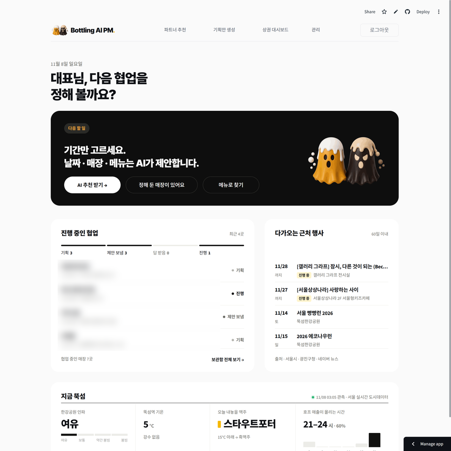
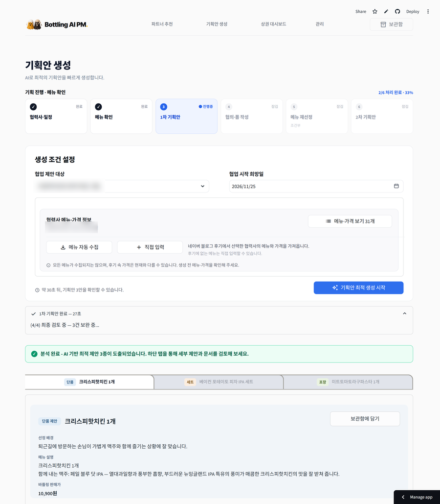
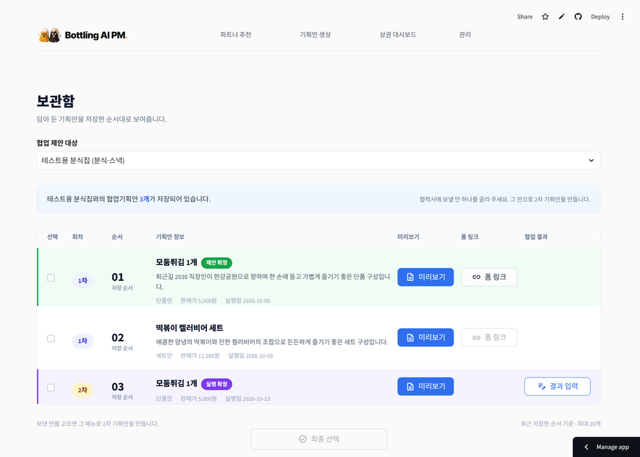
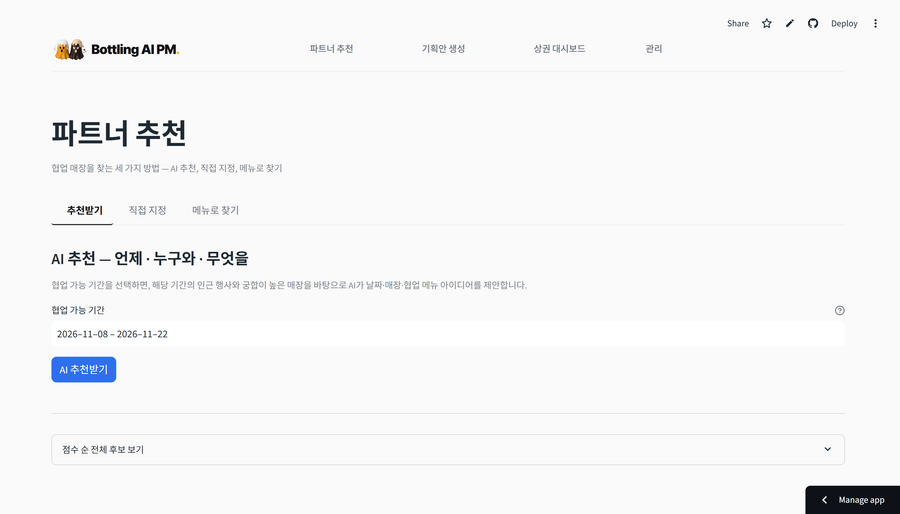
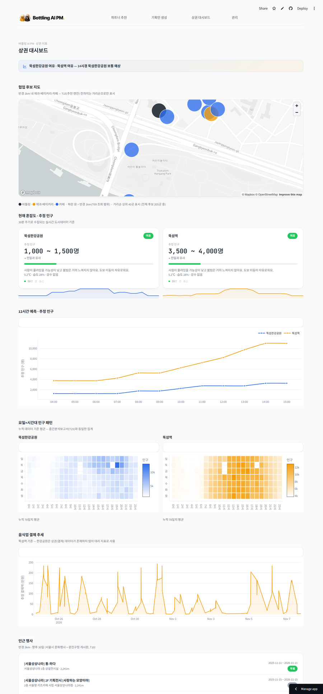
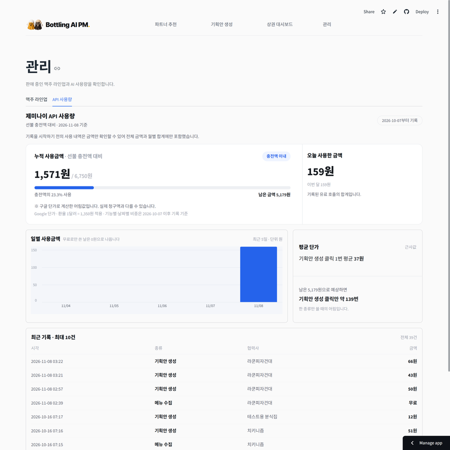
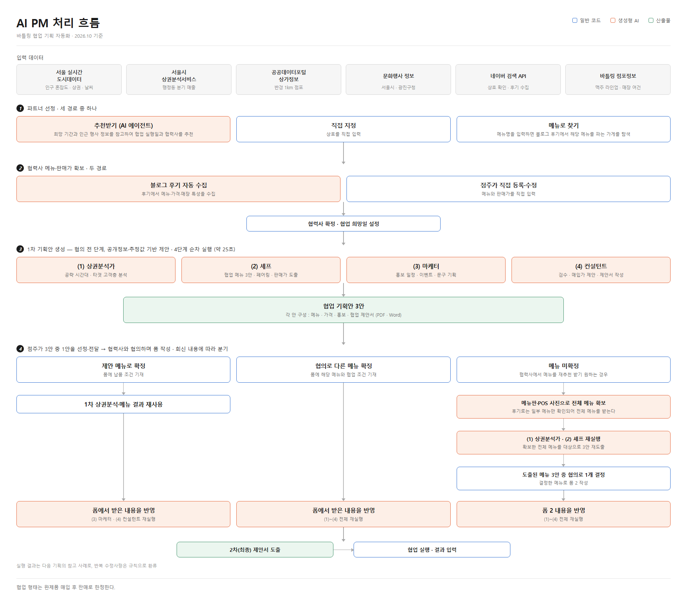

# 바틀링 AI PM

소상공인 매장 간 협업 기획을 자동화하는 웹 서비스입니다. 공공 상권 데이터와 인근 행사 정보, 블로그 후기를 근거로
**협업 후보 매장 · 협업 메뉴 · 실행일 · 매입가**를 도출하고, 협력사에 보낼 협업 제안서를 생성합니다.

서울 광진구 뚝섬의 셀프탭 크래프트 맥주 펍 「바틀링」을 대상으로 구축하였으며,
서울 AI재단 소상공인 AI활용 지원사업으로 진행한 프로젝트입니다.

```
파트너 선정  →  기획안 3안 생성  →  협업 제안서 발송  →  협력사 회신 반영 → 최종안
```

<table>
<tr><td><b>생성 시간</b></td><td>기획안 3안 생성까지 약 25초</td></tr>
<tr><td><b>모델</b></td><td>Gemini <code>gemini-3.5-flash-lite</code></td></tr>
</table>

---

## 주요 기능

- **협업 후보 추천** — 협업 가능 기간을 입력하면 인근 행사와 업종 적합도를 근거로 날짜·매장·메뉴를 1~5위로 제안합니다.
- **메뉴로 매장 찾기** — 메뉴명으로 블로그 후기를 검색해 해당 메뉴를 취급하는 인근 매장을 탐색합니다.
- **기획안 자동 생성** — 4단계 AI 체인으로 단품·세트·포장 세 가지 접근의 기획안을 생성합니다.
- **협업 제안서 출력** — 역할분담·상호 이익·제안 배경·매입가를 포함한 PDF·Word 문서를 생성합니다.
- **2차 기획안 생성** — 협력사 구글 폼 회신 내용을 반영해 확정안을 다시 생성합니다.
- **생성 결과 자동 검증** — 규칙 위반을 코드로 탐지하고 해당 단계를 재실행합니다.
- **품질 채점** — 고정 테스트셋 9건에 6개 항목 루브릭을 적용해 프롬프트 버전 간 품질을 비교합니다.
- **상권 대시보드** — 실시간 인구·혼잡도·결제 현황과 인근 행사를 시각화합니다.

---

## 화면

| 화면 | 하는 일 |
|---|---|
| 기획안 생성 | 협력사와 실행 희망일을 고르면 단품·세트·포장 3안을 생성합니다. |
| 보관함 | 생성한 안을 담아 두고 협력사에 보낼 하나를 확정합니다. |
| 파트너 추천 | 협업 후보를 AI 추천·직접 입력·메뉴로 찾기 세 경로로 찾습니다. |
| 상권 대시보드 | 실시간 인구·혼잡도·결제 현황과 인근 행사를 보여 줍니다. |
| 관리 | 맥주 라인업과 API 사용량을 관리합니다. |



<details>
<summary><b>기획안 생성</b></summary>



</details>

<details>
<summary><b>보관함</b></summary>



</details>

<details>
<summary><b>파트너 추천</b></summary>



</details>

<details>
<summary><b>상권 대시보드</b></summary>



</details>

<details>
<summary><b>관리</b></summary>



</details>

---

## 아키텍처



### AI 체인

앞 단계의 출력이 다음 단계의 입력이 되는 4단계 순차 체인입니다.

| 단계 | 역할 | 주요 출력 |
|---|---|---|
| (1) 상권 분석가 | 공략 시간대·타겟 고객층 도출 | 공략 시간대, 타겟 고객층, 업종별 소비 수준 |
| (2) 셰프 | 협력사 메뉴로 3안 구성 | 메뉴명, 구성, 판매가, 페어링 맥주 |
| (3) 마케터 | 안별 이벤트·홍보 기획 | 이벤트안, 홍보 문구, 해시태그, 홍보 일정 |
| (4) 컨설턴트 | 검수 및 제안서 문장 작성 | 역할분담, 상호 이익, 제안 배경, 개당 매입가 |

### AI와 코드의 역할 분리

판정 기준이 명확한 작업은 코드가, 맥락을 읽어야 하는 판단은 AI가 담당하도록 나누었습니다.

| 담당 | 하는 일 |
|---|---|
| **AI** | 상권 지표 해석과 공략 시간대·타겟 고객층 선정<br>협력사 메뉴 중 맥주와 어울리는 조합 선별, 판매가·매입가 산정<br>이벤트·홍보 기획과 제안서 문장 작성<br>블로그 후기에서 메뉴·가격·매장 특성 추출, 메뉴판 사진 판독<br>뉴스 기사에서 인근 행사 선별<br>생성된 기획안의 품질 채점 |
| **코드** | 수치 집계와 프롬프트 문맥 변환<br>거리·업종 적합도 기반 후보 점수 계산<br>생성 결과의 규칙 위반 검증과 재실행 제어 |

규칙 검증에서 보는 항목은 다음과 같습니다.

```
협력사가 판매하지 않는 메뉴를 가져왔는가
한 기획안 안에서 맥주 이름이 서로 다른가
매입가가 판매가보다 높은가
세트 가격이 낱개 합보다 비싼가
상권 데이터에 없는 수치를 적었는가
```

### 데이터 수집

| 데이터 | 출처 | 주기 |
|---|---|---|
| 실시간 인구·혼잡도·날씨 | 서울 실시간 도시데이터 | 30분 (GitHub Actions) |
| 실시간 상권 결제 현황 | 서울 실시간 도시데이터 | 30분 |
| 추정 매출 (업종×요일×시간대×연령) | 서울시 상권분석서비스 | 분기 |
| 반경 1km 점포 | 공공데이터포털 상가정보 | 월 |
| 문화행사 | 서울시 문화행사 API · 광진구청 · 네이버 뉴스 | 일 |
| 협력사 메뉴·가격, 매장 특성 | 네이버 블로그 검색 API | 수집 시 |
| 납품 조건·협의 결과 | Google Forms → Apps Script → Supabase | 회신 시 |

실시간 도시데이터는 과거 조회가 불가능하므로 30분 주기로 축적하고 있습니다.

---

## 기술 스택

| 영역 | 사용 기술 |
|---|---|
| Frontend | Streamlit |
| Database | Supabase (PostgreSQL) |
| LLM | Google Gemini (`google-genai`) |
| 문서 생성 | reportlab (PDF), python-docx (Word) |
| 데이터 수집 | GitHub Actions, requests, BeautifulSoup |
| 데이터 처리 | pandas, pyproj |
| 배포 | Streamlit Community Cloud |

---

## 프로젝트 구조

```
app/           Streamlit 화면 (기획안 생성 · 파트너 추천 · 상권 대시보드 · 관리)
chain/         AI 체인 실행, 입력 조립, 생성 결과 검증
prompts/       프롬프트 YAML (단계별 프롬프트 · 제약 조건 · 채점 기준)
context/       DB 수치를 프롬프트 문맥으로 변환
collectors/    실시간 데이터·블로그 후기·메뉴판 사진 수집
ingest/        수집 데이터 적재
recommender/   협업 후보 점수화, AI 추천, 메뉴 검색
db/            스키마·마이그레이션·클라이언트
tests/         체인 검증, 고정 테스트셋, 품질 채점
scripts/       Apps Script 연동 등 보조 스크립트
docs/          기획서·개발명세서·설계 기록
```

프롬프트는 코드에서 분리해 `prompts/*.yaml` 로 관리합니다. 

---

## 시작하기

### 요구 사항

- Python 3.12
- Supabase 프로젝트
- Gemini API 키, 서울 열린데이터광장·공공데이터포털·네이버 검색 API 키

### 설치

```bash
git clone https://github.com/ygjung03/bottling-ai-pm.git
cd bottling-ai-pm

python -m venv .venv
.venv\Scripts\activate          # macOS·Linux: source .venv/bin/activate
pip install -r requirements.txt
```

### 환경 변수

`.env.example` 을 복사해 `.env` 를 만들고 값을 채웁니다.

```bash
cp .env.example .env
```

| 변수 | 용도 |
|---|---|
| `SEOUL_API_KEY` | 서울 실시간 도시데이터 |
| `DATA_GO_KR_KEY` | 공공데이터포털 상가정보 |
| `SEOUL_CULTURE_KEY` | 서울시 문화행사 |
| `NAVER_CLIENT_ID` / `NAVER_CLIENT_SECRET` | 네이버 검색 API |
| `SUPABASE_URL` / `SUPABASE_KEY` | Supabase |
| `GEMINI_API_KEY` / `GEMINI_API_KEY_PAID` | Gemini 무료·유료 키 |
| `PARTNER_FORM_URL` / `PARTNER_FORM_CODE_ENTRY` | 협력사 협의 입력 폼 |

### 데이터베이스

`db/README.md` 의 순서대로 실행합니다. `schema.sql` 만으로는 현재 스키마가 되지 않습니다.

```
schema.sql → migrate_*.sql → rls_0928.sql → grants_1030.sql
```

### 실행

```bash
streamlit run app/main.py
```

---

## 테스트

```bash
python -m tests.test_context        # 컨텍스트 빌더 검증
python -m tests.test_chain          # 체인 배선 검증 (LLM 호출 없음)
python -m tests.test_p4             # 단계별 프롬프트 검증
python -m tests.test_fixed --run    # 고정 테스트셋 9건 생성
python -m tests.test_fixed --grade  # 생성 결과 품질 채점
```

콘솔 인코딩이 cp949인 환경에서는 `PYTHONIOENCODING=utf-8` 을 지정합니다.

---

## 문서

| 문서 | 내용 |
|---|---|
| [`docs/기획서.md`](docs/기획서.md) | 배경, 범위, 시스템 설계, 성과 측정 |
| [`docs/개발명세서.md`](docs/개발명세서.md) | 프롬프트 원문, DB 스키마, 추천 엔진 수식 (9월 기준 설계 기록) |
| [`docs/AI_기획안_품질검증_체계.md`](docs/AI_기획안_품질검증_체계.md) | 품질 채점 항목과 점수 기준, 기준이 바뀐 경위 |
| [`docs/메뉴수집_검색전략_측정기록.md`](docs/메뉴수집_검색전략_측정기록.md) | 블로그 후기 수집 방식 비교 측정 |
| [`db/README.md`](db/README.md) | DB 구축 순서 |

---

서울 AI재단 소상공인 AI활용 지원사업 · 청년팀 소복소복 × 바틀링
